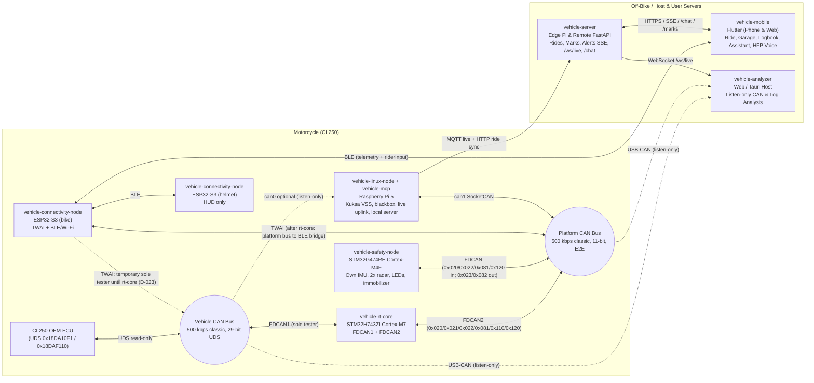

# System Context

**Caption:** Top-level hardware and software topology of `vehicle-platform`, showing physical isolation between the OEM vehicle CAN bus (single read-only tester: rt-core, or the bike ESP32 until rt-core runs, D-023; never both) and the dedicated platform CAN bus, the separate Cortex-M4F safety MCU, the Raspberry Pi 5 HPC, edge/remote servers, the companion app, and the listen-only analyzer.

## Sources
- `vehicle-defs/docs/ARCHITECTURE.md` §2 (Units), §3 (Bus topology — two separate CAN buses), §4 (Platform CAN ID plan), §7 (Data flows)
- `vehicle-defs/docs/DECISIONS.md`: D-009 (two separate CAN buses), D-019 (CL250 poll-based UDS 500 kbps), D-021 (rt-core sole vehicle-bus tester and republisher), D-023 (connectivity-node temporary sole tester), D-073 (helmet ESP32 HUD over BLE), D-077 (edge Pi + remote server), D-081 (listen-only vehicle-analyzer), D-118 (two chips: H743 rt-core + separate G474 safety-node), D-121 (rider assistant & phone HFP intercom voice)
