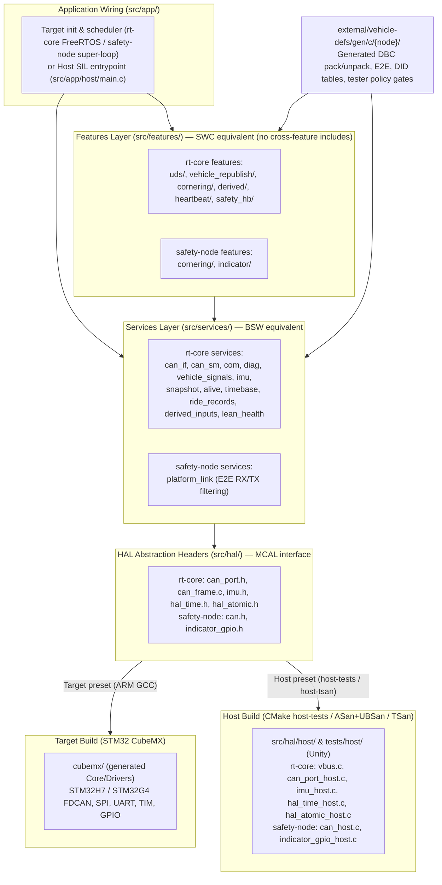

# MCU Firmware Layering (Target vs. Host Port)

**Caption:** One-way layered architecture (`features -> services -> hal`) shared by `vehicle-rt-core` (STM32H743ZI, FreeRTOS) and `vehicle-safety-node` (STM32G474RE, bare-metal), showing how pure logic and services compile identically against either CubeMX target HAL or host simulation ports for unit and SIL testing.

## Sources
- `vehicle-defs/docs/ARCHITECTURE.md` §5 (Signal definition pipeline), §6 (Software layers — AUTOSAR concept mapping)
- `vehicle-defs/docs/DECISIONS.md`: D-012 (FreeRTOS on rt-core, bare-metal on safety-node), D-027 (per-node filtered `gen/c/<node>/`), D-118 (separate H743 and G474 MCUs)
- `vehicle-rt-core/src/` directory layout (`src/app/`, `src/features/`, `src/services/`, `src/hal/`, `src/hal/host/`)
- `vehicle-safety-node/src/` directory layout (`src/app/`, `src/features/`, `src/services/`, `src/hal/`, `src/hal/host/`)
