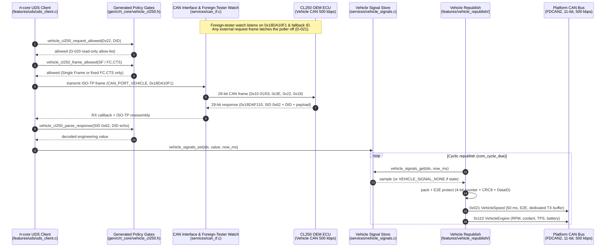

# Read-Only UDS Polling and Platform-Bus Republish

**Caption:** Sequence showing how `vehicle-rt-core` enforces the single-tester and read-only allow-list gates on the CL250 vehicle CAN bus before storing decoded samples and republishing them on the dedicated platform CAN bus (`0x021` with E2E, `0x110` engine state).

## Sources
- `vehicle-defs/docs/DECISIONS.md`: D-019 (CL250 29-bit `0x18DA10F1` -> `0x18DAF110`), D-020 (vehicle-bus service allow-list), D-021 (sole tester + platform-bus republish), D-027 (generated `vehicle_cl250_request_allowed`, `vehicle_cl250_frame_allowed`, `vehicle_cl250_parse_response`), D-037 (single read-only tester), D-059 (FC.CTS multi-frame receive cap)
- `vehicle-defs/docs/ARCHITECTURE.md` §3, §4
- `vehicle-rt-core/src/features/uds/uds_client.c` (lines 34-80: `on_foreign_request`, `latch`, `uds_client_open`)
- `vehicle-rt-core/src/features/vehicle_republish/vehicle_republish.c` (`send_speed`, `send_engine`, `vehicle_republish_open`, `vehicle_republish_step`)
