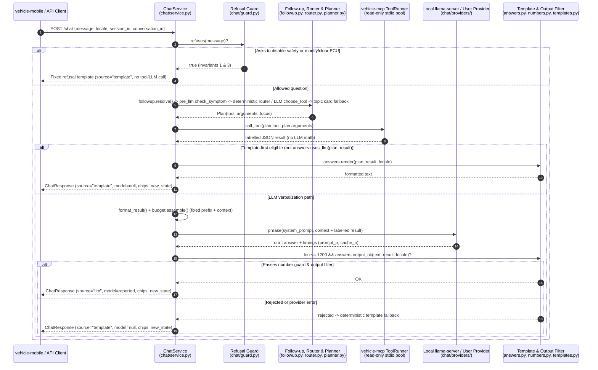

# Rider Assistant `/chat` Pipeline

**Caption:** Fixed single-tool execution pipeline of `POST /chat` in `vehicle-server` (D-121, D-127, D-128): refusal guard before routing, deterministic follow-up / symptom / keyword routing with LLM planner fallback, read-only `vehicle-mcp` tool call, template-first rendering or LLM verbalization checked by the number/output filter.

## Sources
- `vehicle-defs/docs/DECISIONS.md`: D-121 (LLM only verbalizes, single read-only MCP tool, number guard, template fallback), D-124 (optional per-user cloud provider with local fallback), D-127 (answering model visible, deterministic symptom check, labelled results), D-128 (stored conversations, code-carried follow-ups, memory commands, chips)
- `vehicle-server/src/vehicle_server/chat/service.py` (`ChatService.answer`, `_run`, `_choose`, `_symptom_step`, `_topic_card`, `_phrase`, `format_result`)
- `vehicle-server/src/vehicle_server/chat/guard.py` (`refuses`)
