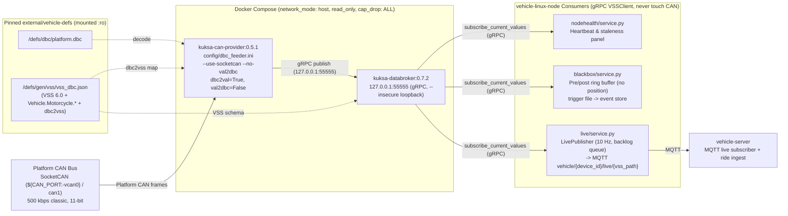

# Raspberry Pi 5 Data Flow (CAN -> Kuksa VSS -> Consumers)

**Caption:** Data flow inside `vehicle-linux-node` on the Raspberry Pi 5: `kuksa-can-provider` decodes platform-bus SocketCAN frames one-way (`dbc2val = True`, `val2dbc = False`) using `platform.dbc` and `vss_dbc.json` into the loopback Kuksa Databroker (`grpc://127.0.0.1:55555`), which serves read-only gRPC VSS consumers without any consumer touching SocketCAN directly.

## Sources
- `vehicle-linux-node/docker-compose.yml` (services `databroker` 0.7.2 on `127.0.0.1:55555` and `can-provider` 0.5.1 with `--no-val2dbc`, `--use-socketcan`, read-only defs mounts, container hardening)
- `vehicle-linux-node/config/dbc_feeder.ini` (`address = grpc://127.0.0.1:55555`, `mapping = /defs/gen/vss/vss_dbc.json`, `dbc2val = True`, `val2dbc = False`, `dbcfile = /defs/dbc/platform.dbc`)
- `vehicle-linux-node/src/vehicle_linux_node/nodehealth/service.py`, `blackbox/service.py`, `live/service.py`
- `vehicle-defs/docs/ARCHITECTURE.md` §5, §7 (VSS and Cloud flows)
- `vehicle-defs/docs/DECISIONS.md`: D-004 (Kuksa CAN->VSS), D-021 (Raspi reads platform bus), D-076 (position excluded by default in blackbox/live)
