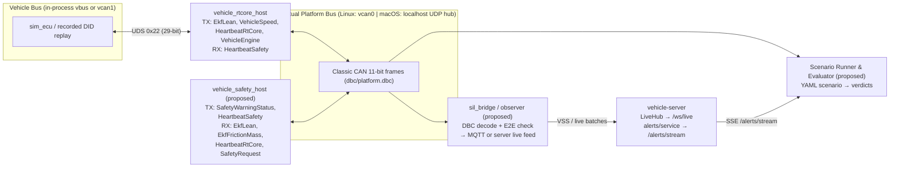

# Multi-Node Software-in-the-Loop (SIL) Design Note (Proposed, T69)

Status: **proposed** design note (not a recorded decision; input for Claude's T69 review).  
Sources: `docs/ideas/sil-inventory.md` (run 4 inventory), `dbc/platform.dbc`, `docs/DECISIONS.md`, and the host ports inspected in `vehicle-rt-core`, `vehicle-safety-node`, `vehicle-server`, `vehicle-linux-node`, and `vehicle-hil-bench`.

---

## 1. Goal and Scope (Proposed)

Run three host-built platform nodes together on **one virtual platform CAN bus** without physical hardware:

1. **`vehicle-rt-core`** host build (sole simulated vehicle-bus UDS tester + platform-bus publisher and `HeartbeatSafety` monitor).
2. **`vehicle-safety-node`** host build (isolated safety application: E2E-checked platform-bus RX, cornering decision with fallback IMU, `SafetyWarningStatus` and `HeartbeatSafety` TX).
3. **`vehicle-server`** live ingestion path (consuming platform-bus telemetry/alerts from the virtual bus, as a proposed, opt-in live source (today `VEHICLE_MQTT_URL` cannot be combined with `VEHICLE_LIVE_SOURCE=mock`, `api.py` raises `ValueError`), and serving `/ws/live` and `/alerts/stream`).

Design constraints from recorded decisions (never altered here):
- Platform bus is classic CAN 500 kbps, 11-bit IDs, independent of the CL250 vehicle bus (D-009, D-021, `dbc/platform.dbc`).
- `vehicle-safety-node` remains strictly isolated from `vehicle-rt-core` sources and `gen/c/rt_core` (`vehicle-safety-node/.github/workflows/ci.yml` lines 96-103; D-118; invariant 3).
- `vehicle-rt-core` never receives or interprets `SafetyWarningStatus` (`0x023`) and treats `HeartbeatSafety` (`0x082`) as diagnostic-only (`vehicle-rt-core/.github/workflows/ci.yml` lines 214-234 and 257-258 hold the diagnostic-only rule; D-118 item 6 only says SAFETY frames are received like any platform frame).
- `sim_safety` inside `vehicle-rt-core` stays bound to the in-process `vbus_t` only and never touches SocketCAN (`vehicle-rt-core/.github/workflows/ci.yml` lines 247-256).

---

## 2. What Each Repo's Host Port Already Supports (Facts)

| Repo | Host port files | Bus backend today | Timebase today | Relevant constraints in code / CI |
|---|---|---|---|---|
| **`vehicle-rt-core`** | `src/hal/host/can_port_host.c`, `vbus.c`, `hal_time_host.c`, `imu_host.c`, `src/app/host/main.c`, `sim_ecu.c`, `sim_safety.c`, `sim_listener.c`, `sim_tester.c` | `CAN_PORT_VEHICLE`: in-process `vbus_t` (default) or Linux SocketCAN via `--vcan IF` (`main.c:265-290`; `HAVE_SOCKETCAN` is `1` only under `#if defined(__linux__)`, `can_port_host.c:5-17`, else `can_port_host_bind_socketcan()` returns `false`, `can_port_host.c:151-156`). `CAN_PORT_PLATFORM`: always in-process `vbus_t platform_bus` (`main.c:292-301`) with `sim_safety` always attached and stepping (`main.c:297,366`, `sim_safety.c:8-39`). | `hal_time_host.h:16-21` supports both `CLOCK_MONOTONIC` (default) and manual stepped time (`hal_time_host_use_manual` / `hal_time_host_advance`). `main.c:350-388` uses `CLOCK_MONOTONIC` with `LOOP_PERIOD_MS = 1u` sleep. | `sim_safety` always sends `HeartbeatSafety` (`0x082`) every 100 ms (`sim_safety.c:26-37`), colliding with any real `safety-node` on the same platform bus. CI checks that `sim_safety.c` never includes SocketCAN headers and `sim_safety_init` receives `&platform_bus` (`ci.yml:249-256`). |
| **`vehicle-safety-node`** | `src/hal/host/can_host.c`, `indicator_gpio_host.c`, `src/app/safety_app.c` | In-memory unit-test ring buffers only (`can_host.c:11-172`: `can_host_inject(rx_class, frame)` and `can_host_tx_pop(frame)`). Two RX classes (`HAL_CAN_RX_SAFETY`, `HAL_CAN_RX_QM`) checked by `platform_link.c:32-44,117-120`. No SocketCAN, UDP, or `vbus_t` backend, and no standalone host `main()` executable (`docs/ideas/sil-inventory.md` §1, §3.1). | Caller-driven `uint32_t now_ms` passed to `safety_app_init(now_ms)` and `safety_app_step(now_ms)` (`safety_app.h:59-62`). Enforces `SAFETY_APP_PASS_MAX_MS = 5u` (`safety_app.h:37`, `safety_app.c:19`). | `app/` never includes `hal/` (`ci.yml:146-149`); only `src/services/platform_link.c` and `src/hal/` include `hal/can.h` (`ci.yml:112-121`). |
| **`vehicle-server`** | `src/vehicle_server/mock_stream.py`, `mqtt_live.py`, `stream.py`, `alerts/service.py` | `VEHICLE_LIVE_SOURCE=mock` runs in-process `MockCanStreamer` (`mock_stream.py:67-243`, scenarios `normal\|overheat\|weak-charging\|dropout` or recorded `telemetry.csv` fixtures); `VEHICLE_MQTT_URL` consumes MQTT VSS topics (`mqtt_live.py`, D-109). No direct SocketCAN or UDP CAN listener today (`docs/ideas/sil-inventory.md` §3.1). | `MockCanStreamer` steps at 20 ms (`_step * 20 / 1000.0`) stamped with host wall/monotonic `timestamp_us` (`docs/ideas/sil-inventory.md` §3.3); `alerts/service.py` runs on server receive time (`vehicle-server/README.md`). | Position-looking signals are rejected by `position.py` (D-076). |
| **`vehicle-linux-node`** *(optional consumer)* | `src/vehicle_linux_node/replay.py`, `docker-compose.yml` | `replay.py` emits `candump` logs for `vcan0` (no E2E fields populated, `docs/ideas/sil-inventory.md` §2, §3.2); Kuksa `kuksa-can-provider` bridges `vcan0` → VSS → MQTT on Linux Docker (`docs/ideas/sil-inventory.md` §1). | Replay uses 0.1 s steps (20 cycles). | Not required in the minimal 3-node SIL loop if a lightweight CAN→`vehicle-server` bridge feeds `LiveHub` or MQTT directly. |

---

## 3. Platform-Bus Message Matrix (`dbc/platform.dbc`)

Message names, numeric IDs, cycle times, E2E attributes, and senders/receivers below are quoted directly from `dbc/platform.dbc` (lines 21-99 and 166-193). The last column states how each message participates in the **proposed** 3-node SIL run.

| DBC Message Name | DBC ID (dec / hex) | Cycle / E2E (`dbc/platform.dbc`) | DBC TX → RX | Current Host Status | Role in Proposed 3-Node SIL Run (**Proposed**) |
|---|---|---|---|---|---|
| `EkfLean` | `32` (`0x020`) | 20 ms / E2E Yes (`DataID 4128`) | `RT_CORE` → `SAFETY, LINUX` | `rt-core` TX (`main.c:334,380`); `safety-node` RX (`platform_link.c:33`, `HAL_CAN_RX_SAFETY`) | Primary closed-loop safety input: `rt-core` TX → virtual bus → `safety-node` RX (and observer/server tap). |
| `VehicleSpeed` | `33` (`0x021`) | 50 ms / E2E Yes (`DataID 4129`) | `RT_CORE` → `CONN, LINUX` | `rt-core` TX (`main.c:315,380`); rejected by `safety-node` filter (D-041) | `rt-core` TX → virtual bus → `vehicle-server` bridge RX (and scenario observer). Never routed into `safety-node`. |
| `EkfFrictionMass` | `34` (`0x022`) | 100 ms / E2E Yes (`DataID 4130`) | `RT_CORE` → `SAFETY, LINUX` | Not wired in `rt-core` host `main.c`; `safety-node` RX (`platform_link.c:35`, `HAL_CAN_RX_SAFETY`) | Initially absent in SIL (exercising D-029/D-042 default friction/mass fallback in `safety-node`) until `rt-core` adds `0x022` TX, or injected by a scenario peer when testing non-default friction/mass. |
| `SafetyWarningStatus` | `35` (`0x023`) | 20 ms / E2E Yes (`DataID 4131`) | `SAFETY` → `RT_CORE, CONN, LINUX` | `safety-node` TX (`safety_app.c:77-106`, `platform_link.c:231`); absent from `rt-core/src/` (`ci.yml:217-220`) | `safety-node` TX → virtual bus → scenario evaluator & `vehicle-server` bridge RX (observability of cornering level/source, BSM, immobilizer state). Never consumed by `rt-core`. |
| `HeartbeatRtCore` | `129` (`0x081`) | 100 ms / E2E Yes (`DataID 4225`) | `RT_CORE` → `SAFETY, CONN, LINUX` | `rt-core` TX (`main.c:320,380`); `safety-node` RX (`platform_link.c:38`, `HAL_CAN_RX_SAFETY`) | `rt-core` TX → virtual bus → `safety-node` RX (gating EKF trust per D-042 item 3) and `vehicle-server` bridge RX. |
| `HeartbeatSafety` | `130` (`0x082`) | 100 ms / E2E Yes (`DataID 4226`) | `SAFETY` → `RT_CORE, LINUX` | `safety-node` TX (`safety_app.c`, `platform_link.c:233`); `rt-core` RX (`safety_hb`, `main.c:324,380`) + stub `sim_safety` TX (`sim_safety.c:26`) | Real `safety-node` TX → virtual bus → `rt-core` `safety_hb` RX (diagnostic-only DTC `SAFETY_HEARTBEAT_LOST`: `uds/dids.yaml` `diagnostic_only: true`, enforced by `vehicle-rt-core/.github/workflows/ci.yml` ~226-229, 257-258; D-118 item 6 covers reception). `sim_safety` must be disabled whenever real `safety-node` is on the bus. |
| `HeartbeatConn` | `132` (`0x084`) | 100 ms / E2E Yes (`DataID 4228`) | `CONN` → `RT_CORE, LINUX` | Not active in 3-node subset | Out of scope for minimal 3-node SIL (`vehicle-connectivity-node` has no platform-bus host simulation, `docs/ideas/sil-inventory.md` §1). |
| `HeartbeatLinux` | `133` (`0x085`) | 100 ms / E2E Yes (`DataID 4229`) | `LINUX` → `RT_CORE` | Not active in 3-node subset | Out of scope for minimal 3-node SIL. |
| `VehicleEngine` | `272` (`0x110`) | 50 ms / E2E No | `RT_CORE` → `CONN, LINUX` | `rt-core` TX (`main.c:315,380`); rejected by `safety-node` filter | `rt-core` TX → virtual bus → `vehicle-server` bridge RX (feeds `ENGINE_SPEED`, `BATTERY_VOLTAGE`, `COOLANT_TEMP`, `THROTTLE_POS`, `ECU_PRESENT` into `LiveHub` and D-129 alert engine). |
| `SafetyRequest` | `288` (`0x120`) | 100 ms / E2E Yes (`DataID 4384`) | `RT_CORE` → `SAFETY` | Not wired in `rt-core` host `main.c`; `safety-node` RX (`platform_link.c:41`, `HAL_CAN_RX_QM`) | Absent in initial SIL (immobilizer stays `UNKNOWN`/`UNLOCKED` per invariant 6); later injected only by a dedicated `rt-core` sender (`ci.yml:269-279`) or a test-only scenario injector. |

*(Vehicle-bus UDS polling `0x18DA10F1` → `0x18DAF110` remains strictly on `CAN_PORT_VEHICLE` inside `rt-core` + `sim_ecu` or a separate vehicle-bus `vcan1`; it never crosses onto the platform virtual bus, per D-009 and D-021.)*

---

## 4. Proposed Virtual Bus Architecture (Linux CI vs macOS)

To keep `vehicle-rt-core` and `vehicle-safety-node` completely build-isolated (preserving `vehicle-safety-node/.github/workflows/ci.yml:96-103`) while running both on Linux CI and macOS developer hosts, this note **proposes** a **dual-transport host bus** behind each repo's `src/hal/host/` layer:



### 4.1 Transport A: Linux CI — SocketCAN `vcan` (**Proposed**)

- **Why:** `vehicle-rt-core/src/hal/host/can_port_host.c:57-147` already implements `BACKEND_SOCKETCAN` (`HAVE_SOCKETCAN == 1` on Linux) with `CAN_RAW` non-blocking sockets and `CAN_RAW_FILTER`, and `vehicle-rt-core/.github/workflows/ci.yml:71-79` already provisions `vcan0` on `ubuntu-24.04`.
- **Proposed changes:**
  - `vehicle-rt-core`: add `--platform-vcan <if>` (validating the `vcan` prefix, analogous to `--vcan` at `main.c:276-280`) and `--no-sim-safety` (skipping `sim_safety_init` / `sim_safety_step` when external `safety-node` is on the bus, while keeping `sim_safety.c` itself strictly `vbus_t`-only so `ci.yml:249-256` stays green).
  - `vehicle-safety-node`: add a host-only runner (`src/app/host/` + SocketCAN backend in `src/hal/host/`, excluded from MISRA/target coverage just as `src/hal/host/` already is in `vehicle-safety-node/.github/workflows/ci.yml:81,177`) that classifies incoming frames into `HAL_CAN_RX_SAFETY` (`EkfLean`, `EkfFrictionMass`, `HeartbeatRtCore`) and `HAL_CAN_RX_QM` (`SafetyRequest`) according to `platform_link.c:32-44` before calling `can_host_inject()`, and drains `can_host_tx_pop()` to the socket.
  - `vehicle-server`: consume decoded frames via a small **proposed** Python `python-can` + `cantools` bridge (reading `dbc/platform.dbc` from `vehicle-defs`) that publishes to `vehicle-server`'s existing `mqtt_live.py` path (D-109) or an opt-in local SIL live-source adapter feeding `LiveHub.publish` (no hand-written CAN IDs, invariant 2).

### 4.2 Transport B: macOS Developer Host — Localhost UDP Hub vs In-Process Harness (**Proposed**)

macOS has no kernel SocketCAN (`HAVE_SOCKETCAN == 0` in `can_port_host.c:16`). Two options are **proposed** (Claude decides which to adopt in T69):

- **Option B1 (Proposed — Localhost UDP / Unix-domain datagram CAN hub):**
  - A tiny POSIX-only host transport (`BACKEND_UDP` in `src/hal/host/` of `rt-core` and `safety-node`, plus the same 16-byte frame format `{uint32_t id_flags, uint8_t dlc, uint8_t pad[3], uint8_t data[8]}` in Python) sends frames to a local hub process on `127.0.0.1:<port>` (or a Unix `AF_UNIX` `SOCK_DGRAM` socket) that fans every frame out to all other connected peers (never back to the sender, matching CAN and `vbus.h:7-8`).
  - **Pros:** Same multi-process topology as Linux `vcan`, preserves strict repo/build isolation between `rt-core` and `safety-node`, works identically on macOS and Linux (including Linux runners where `modprobe vcan` fails, `ci.yml:78`).
  - **Cons:** Wall-clock pacing on macOS still suffers OS scheduling jitter (`docs/ideas/sil-inventory.md` §3.3 observed 14 ms and 20 ms step gaps in rt-core's host loop, above its `VEHICLE_CL250_CLIENT_STEP_MAX_MS = 10 ms` bound (D-053); safety-node has no host loop, so `SAFETY_APP_PASS_MAX_MS = 5 ms` overruns are an expected risk, not observed) unless paired with an explicit tick-barrier message on the hub.
- **Option B2 (Proposed — Lockstep in-process C harness / Python `ctypes` wrapper):**
  - Compile `rt-core` and `safety-node` as separate static/shared host libraries (each built inside its own repo with its own `gen/c/<node>`) and step both from one external orchestrator that owns a single virtual `now_ms` counter (`hal_time_host_use_manual` + `hal_time_host_advance` in `rt-core`, `safety_app_step(now_ms)` in `safety-node`) and copies frames between `vbus_t` and `can_host_inject`/`can_host_tx_pop` on every 1 ms tick.
  - **Pros:** 100% deterministic, zero macOS timer jitter, runs faster than real time (a 60 s ride scenario executes in < 1 s), works identically on macOS and Linux with zero kernel modules.
  - **Cons:** Requires keeping link-time symbol namespaces disjoint if linked into one binary (e.g. via separate `dlopen` shared libraries with `RTLD_LOCAL`, since both nodes compile `vehicle_e2e` and `platform.c` generated symbols) and differs from the multi-process `vcan` topology.

---

## 5. Time Base per Node (Q-008 Remains Open)

`Q-008` ("Time synchronization: how is GPS PPS/NTP distributed to the MCUs?", `docs/DECISIONS.md` line 1135) is **open**; this design note **decides nothing** about on-vehicle time synchronization.

In today's host code, each node uses a different time base:
- **`vehicle-rt-core`:** 32-bit millisecond `timebase_now_ms()` backed by `hal_time_host.c` (`CLOCK_MONOTONIC` by default, or manual stepped clock via `hal_time_host_use_manual()` / `hal_time_host_advance()`, `hal_time_host.h:16-18`). `main.c:388` sleeps 1 ms per iteration; `VEHICLE_CL250_CLIENT_STEP_MAX_MS` is 10 ms (D-053).
- **`vehicle-safety-node`:** Caller-supplied 32-bit millisecond `now_ms` (`safety_app.h:59-62`). `safety_app.c:19` enforces `SAFETY_APP_PASS_MAX_MS = 5u` ms (four passes per 20 ms `EkfLean` cycle, D-101 item 2), and `platform_link.c` runs E2E timeout checks against `now_ms`.
- **`vehicle-server`:** Wall-clock UTC timestamps (`datetime.now(UTC)`) for session windows, notifications, and alert timestamps; `alerts/service.py` evaluates sustain/cooldown timers on server receive time (`vehicle-server/README.md`), while `mock_stream.py` advances synthetic dynamics on a fixed 20 ms step counter (`docs/ideas/sil-inventory.md` §3.3).

### Proposed SIL Time-Base Options (No Decision Made — Q-008 Open)

1. **Wall-clock `CLOCK_MONOTONIC` per process (free-running, real-time):**
   - Each node reads its own monotonic clock (`vcan` or UDP hub). Matches asynchronous MCU reality (independent oscillators, no shared clock), but exposes host tests to OS scheduler jitter (14 ms and 20 ms step gaps were observed in rt-core's host loop on macOS, above its `VEHICLE_CL250_CLIENT_STEP_MAX_MS` 10 ms bound, D-053; `SAFETY_APP_PASS_MAX_MS = 5 ms` overruns on safety-node are an expected risk, not observed) and forces a sustained-alert scenario (e.g. ALR-001: `sustain_s: 10`, `while: [engine_running]`, i.e. `did.ENGINE_SPEED` above 0) to take its full duration in wall time.
2. **Orchestrator-stepped virtual clock (`tick` barrier over hub or in-process lockstep):**
   - One orchestrator broadcasts `TICK(now_ms)` (1 ms or 2 ms steps) to `rt-core` (driving `hal_time_host_advance`) and `safety-node` (driving `safety_app_step(now_ms)`), and stamps virtual time into the `vehicle-server` live bridge (using an injectable clock in `alerts/service.py` or post-run `alerts/replay.py`). Eliminates jitter flakes and allows faster-than-real-time execution.
3. **Hybrid (wall-clock on Linux `vcan` smoke with relaxed host-jitter reporting + stepped virtual clock for deterministic fault/timing scenarios):**
   - Keeps a short real-time `vcan` integration smoke test on Linux CI while running timing-sensitive E2E timeout, D-042 fallback, and D-129 alert-sustain scenarios under a stepped virtual clock.

---

## 6. Scenario Execution and Judgement (**Proposed**)

`vehicle-hil-bench` is currently a skeleton (`vehicle-hil-bench/README.md:11`) that specifies vehicle-independent YAML scenarios under `scenarios/` and strictly separates three host modules: **Scenario engine**, **Control panel**, and **Evaluator** (`vehicle-hil-bench/CLAUDE.md:8-10,34-39`).

This note **proposes** reusing that exact split for multi-node SIL so scenarios written now could carry forward to the HIL bench. No scenario schema exists yet in `vehicle-hil-bench`; the YAML below is a new, proposed schema (the only hints are the step list, expected result and timeout in `vehicle-hil-bench/.claude/agents/hil-scenario-validator.md`):

### 6.1 Proposed Scenario YAML Shape (Vehicle-Independent)

```yaml
# New, proposed SIL/HIL scenario schema (no existing schema in vehicle-hil-bench)
name: cornering-ekf-loss-and-overheat
duration_s: 30
time_mode: stepped          # stepped | realtime
inputs:
  vehicle_bus:              # drives sim_ecu DID responses (by defs DID name as in faults/alert_rules.yaml, never raw IDs)
    - at_s: 0.0
      signals: { ENGINE_SPEED: 3500, VEHICLE_SPEED: 60, COOLANT_TEMP: 85, BATTERY_VOLTAGE: 14.1 }
    - at_s: 5.0
      signals: { COOLANT_TEMP: 112 }   # above ALR-001 threshold 110; engine is running (ENGINE_SPEED > 0 since 0.0 s), so the 10 s sustain ends at 15.0 s
  imu_rt_core:              # synthetic roll/gyro profile for rt-core EKF
    - at_s: 0.0
      lean_deg: 0.0
    - at_s: 3.0
      lean_deg: 28.0
  imu_safety_node:          # independent fallback IMU on safety-node
    - at_s: 0.0
      lean_deg: 0.0
    - at_s: 3.0
      lean_deg: 28.0
faults:
  - at_s: 8.0
    action: drop_message    # e.g. drop EkfLean on platform bus to test D-042 fallback
    message: EkfLean
    duration_s: 2.0
assertions:
  - name: safety-uses-ekf-initially
    between_s: [1.0, 7.5]
    message: SafetyWarningStatus
    signal: CORNERING_SOURCE
    equals: EKF
  - name: safety-falls-back-on-ekf-loss
    after_s: 8.5
    within_s: 0.5
    message: SafetyWarningStatus
    signal: CORNERING_SOURCE
    equals: OWN_IMU
  - name: rt-core-sees-no-safety-heartbeat-loss
    # in words: the SAFETY_HEARTBEAT_LOST DTC (uds/dids.yaml) is never set by rt-core
    # while the real safety-node runs (no existing metric name is invented here)
    expect_absent: SAFETY_HEARTBEAT_LOST
  - name: server-raises-overheat-alert-after-sustain
    endpoint: /alerts/stream
    rule: ALR-001            # alerts/service.py, sustain_s 10 on server receive time
    after_s: 15.0
    within_s: 2.0
```

### 6.2 Lifecycle and Judgement (**Proposed**)

1. **Start:** Orchestrator provisions the bus (`vcan0` on Linux CI or local UDP hub / stepped harness), starts `vehicle-server` (in-memory or temporary `VEHICLE_DATA_DIR`, ephemeral bearer token), starts `sil_bridge` + frame recorder, then starts `vehicle_rtcore_host` (with `--no-sim-safety`) and `vehicle_safety_host`.
2. **Drive:** Scenario engine feeds vehicle-bus DID values (to `sim_ecu` or recorded fixture replay) and synthetic IMU streams, and applies scripted bus faults (drop frame, corrupt E2E CRC, freeze E2E counter) at scheduled timestamps.
3. **Record:** Passive bus recorder captures all `dbc/platform.dbc` frames (candump / JSONL) plus `vehicle-server` `/ws/live` batches, `/alerts/stream` events, and node exit codes / summary lines.
4. **Judge:** Evaluator (pure Python, separate from the runner, matching `vehicle-hil-bench/CLAUDE.md:34-39`) decodes the captured bus log via `vehicle-defs` `dbc/platform.dbc` (`cantools`), checks every assertion (E2E validity, transition latency, zero `SAFETY_HEARTBEAT_LOST` unless injected, server alert firing/clearing), and returns exit `0` (pass) or `1` (fail) with a machine-readable report.
5. **Cleanup:** Always stop child processes and remove temporary directories in `finally` without masking the scenario failure reason.

---

## 7. CI Cost Estimate (**Proposed**)

Measured host build and test durations on Apple Silicon macOS (`docs/ideas/sil-inventory.md` §1) and current GitHub Actions setup (`vehicle-rt-core/.github/workflows/ci.yml`, `vehicle-safety-node/.github/workflows/ci.yml`):

| Component | Measured local build/run (`sil-inventory.md` §1) | Estimated Linux CI overhead (`ubuntu-24.04`) |
|---|---|---|
| `vehicle-rt-core` host binary build | incremental build time not measured (full test suite 53.64 s; 2 s SIL smoke 2.18 s) | ~15–25 s clean CMake/Ninja build (cached/no cross-compile needed for SIL job) |
| `vehicle-safety-node` host binary build | 0.56 s (build + 9 tests) | ~5–10 s clean CMake/Ninja build |
| `vehicle-server` startup + `uv sync` | `test_mock_stream.py` 1.05 s | ~15–20 s with `uv` cache |
| `vcan0` setup (`linux-modules-extra`) | N/A (Linux only) | ~10–25 s (`vehicle-rt-core/.github/workflows/ci.yml:71-79`); 0 s if using UDP/stepped transport |
| 3–5 SIL scenarios (10–20 s simulated each) | — | **~5–15 s** if stepped faster-than-real-time; **~60–90 s** if real-time wall clock |
| **Total proposed SIL CI job** | — | **~1–2 min** (stepped) or **~2.5–3 min** (real-time `vcan0`) |

**Proposed CI placement:** Run as a dedicated workflow (e.g. in `vehicle-workspace` or a scheduled/dispatch + release-tag integration workflow, or opt-in PR job) rather than duplicating cross-repo checkouts on every single-repo documentation PR, keeping per-PR CI fast while gating tagged releases and cross-node bus changes.

---

## 8. Gaps to Close Before First Multi-Node SIL Run

Every gap below is verified against the source files listed in §2 and `docs/ideas/sil-inventory.md` §3:

1. **`vehicle-rt-core` platform-bus external transport + disabling `sim_safety`:**
   - `src/app/host/main.c:292-301,366` hard-wires `CAN_PORT_PLATFORM` to in-process `vbus_t platform_bus` and unconditionally runs `sim_safety` (which collides with real `safety-node` on `HeartbeatSafety` `0x082`). Needs `--platform-vcan` (Linux) / `--platform-udp` (cross-platform) and `--no-sim-safety`, while keeping `sim_safety.c` strictly `vbus_t`-only (`ci.yml:249-256`).
2. **`vehicle-safety-node` standalone host executable + bus backend:**
   - No `main()` runner exists yet; `src/hal/host/can_host.c` has only in-memory test FIFOs. Needs a host-only runner (`src/app/host/`) and a SocketCAN / UDP (or stepped) adapter that maps DBC IDs to `HAL_CAN_RX_SAFETY` vs `HAL_CAN_RX_QM` without altering `platform_link.c` or target firmware (red zone: Claude only).
3. **Cross-platform macOS bus transport (`HAVE_SOCKETCAN == 0`):**
   - `vehicle-rt-core/src/hal/host/can_port_host.c:16,151-156` has no non-Linux cross-process backend. Needs either the proposed localhost UDP/Unix-socket hub (Option B1) or the stepped harness (Option B2).
4. **CAN-to-`vehicle-server` SIL bridge:**
   - `vehicle-server/src/vehicle_server/mock_stream.py` synthesizes frames internally; `mqtt_live.py` reads MQTT VSS topics (`vehicle/<device_id>/live/<VSS path>`). Needs a lightweight DBC-driven bridge (`dbc/platform.dbc` → `LiveHub` or local MQTT broker) as a separate, opt-in live source (proposed; `api.py` rejects `VEHICLE_MQTT_URL` with `VEHICLE_LIVE_SOURCE=mock` today) so `vehicle-server` ingests actual frames emitted by `rt-core` and `safety-node`.
5. **Missing platform-bus TX in `rt-core` host (`EkfFrictionMass`, `SafetyRequest`):**
   - `vehicle-rt-core/src/app/host/main.c:315-380` does not transmit `EkfFrictionMass` (`0x022`) or `SafetyRequest` (`0x120`). Until implemented, `safety-node` runs with default friction/mass fallback (D-029/D-042) and no immobilizer lock requests.
6. **Synchronized dynamic sensor inputs (`sim_ecu` + `imu_host` + `safety-node` IMU):**
   - `vehicle-rt-core/src/app/host/main.c:217-226` feeds a hard-coded straight-riding 800 Hz IMU signal (`feed_imu`), and `sim_ecu` serves static synthetic DID values. Closed-loop cornering and alert scenarios need a shared scenario input feed driving `sim_ecu`, `rt-core`'s `imu_host`, and `safety-node`'s fallback IMU together.
7. **Deterministic time / jitter control (related to open Q-008):**
   - Free-running wall-clock loops on macOS already exceeded rt-core's `VEHICLE_CL250_CLIENT_STEP_MAX_MS` (`10 ms`, D-053) with 14 ms and 20 ms gaps (`docs/ideas/sil-inventory.md` §3.3); `SAFETY_APP_PASS_MAX_MS` (`5 ms`, `safety_app.h:37`) overruns are an expected risk on safety-node, not observed (no host loop there). Deterministic CI requires either stepped virtual time (Option 2 in §5) or Linux-only real-time tolerance bounds.
8. **E2E protection in `vehicle-linux-node/src/vehicle_linux_node/replay.py` (if reused):**
   - `replay.py` currently zeroes `E2E_CRC` and `E2E_COUNTER` (`docs/ideas/sil-inventory.md` §3.2), so its generated logs cannot be fed to `safety-node` or `rt-core` without adding `vehicle_defs` E2E protection.
